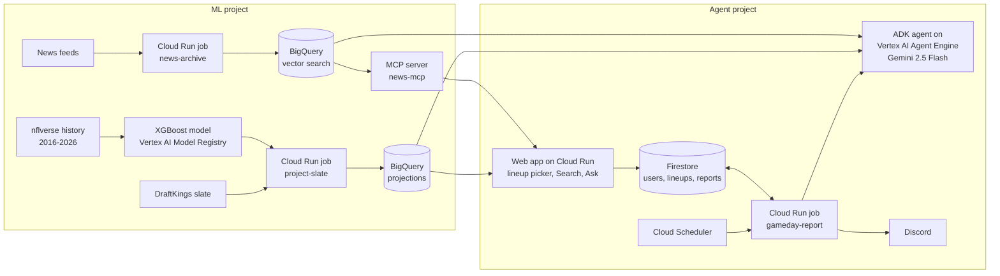

# NFL DFS: projection model, lineup optimizer and a gameday AI agent on Google Cloud

Every week this system predicts how many DraftKings points each NFL player will score,
builds the best legal lineup under the $50,000 salary cap, and then, before kickoff, runs an
AI agent that checks the lineup against injuries, weather, Vegas lines and the news. Scheduled
reports have run in Google Cloud since October 2026. It is multi-user (sign-in, per-user lineups
and reports), tested with four seeded accounts.

The model is deliberately simple. **The system around it is built like production**: evals that
gate every agent deploy, an LLM judge tested with seeded defects, cost metering, prompt-injection
screening, monitoring, and CI/CD.



## Three layers, kept separate on purpose

| Layer | What it does | What kind of code |
|---|---|---|
| **1. Projection model** | Predicts DK points per player (a mean and an 85th-percentile ceiling) | Machine learning: XGBoost trained on 2016-2026 data, walk-forward validated |
| **2. Optimizer** | Picks the 9 players that maximize projected points under the cap and roster rules | **Not AI.** An integer linear program (PuLP + CBC). One exact, reproducible answer |
| **3. Gameday agent** | Reads the news and reconciles it with the lineup: who's out, who's limited, what changed since yesterday | A Google ADK agent on Vertex AI Agent Engine. Most tools are plain Python; the LLM decides which to call and writes the report |

The guiding rule: **anything with one right answer is code; the LLM only handles what exists
only as sentences.** Salaries, injury tags, Vegas totals and projections are Python. Beat
reports and practice notes are where the model earns its keep.

## Results worth knowing

**Evaluation.** The agent is probabilistic, so "it works" is a percentage, not an assert. The
harness in [`gameday_agent/eval/`](gameday_agent/eval/README.md) runs the real agent against
synthetic scenarios (DK outage, prompt injection, an emergency scratch, a clean lineup...) and
reports three numbers that are never averaged together:

- **Checks:** deterministic assertions on the report and the tool trace. Any failure blocks the deploy.
- **Quality:** an LLM judge (Gemini 2.5 Pro) scoring a six-criterion rubric. The judge is tested by seeding known defects into reports and checking it catches them; a hand-grading harness exists, with one report graded so far.
- **Trajectory:** what the agent did: which tools, how many calls, how long.

*"A run can score 100 on quality and be broken."* That's why checks and trajectory gate independently.

**Cost: -68% per report.** Before optimizing anything, I metered everything, and found the
cost meter had been missing 63-87% of the real bill (thinking tokens bill as output, at ~8x the
input price). One lever per commit, each verified on the eval suite and a live dry run: the
daily report went from about $0.035 to $0.011, with every check still passing and the
injection screen still catching 28 of 28 attacks. (News-archive tools added on 10/22
raised it to about $0.020.)

**Agent vs pipeline, measured.** For the archive's "Ask" feature I built both designs and
scored 680 answers against an answer key. The fixed pipeline beat the agent by +0.33 on a 0-2
correctness scale (95% CI +0.23 to +0.43). The agent's main failure: it skipped retrieval on
61 of 340 answers. Write-up: [`ask_eval/README.md`](ask_eval/README.md).

**Search quality.** I built a 150-question test set for the news-archive search, graded by
an LLM judge and cross-checked by a second model (85% agreement on the first key). I then
compared fine-tuning embeddings against adding a re-ranker. The re-ranker won (+0.15 nDCG@10
offline), and a date-aware version of it (+0.12 offline, better on fresh news) is in
production. Write-up: [`embed_tune/README.md`](embed_tune/README.md).

**The model itself, honestly.** It doesn't beat FantasyData's paid projections (within-week
Spearman 0.64 vs 0.67 on dev; a statistical tie on lineup outcomes). The point was the
lifecycle, not the leaderboard.

## Production

| Piece | Where it runs |
|---|---|
| Weekly projections | Cloud Run job + Cloud Scheduler, results in BigQuery |
| Gameday reports, per user | Cloud Run job calling the agent on Agent Engine; lineups read from and reports stored in Firestore, owner's copy to Discord |
| Lineup web app (Search + Ask over the news archive) | Cloud Run service, Firebase Auth sign-in |
| News archive | Daily Cloud Run job, embedded with `text-embedding-005`, searched with BigQuery `VECTOR_SEARCH` + Vertex ranking |
| MCP server | Private Cloud Run service exposing the archive to the web app and to AI clients like Claude Code |
| CI/CD | Cloud Build: unit tests on every push; agent deploys pass the eval gate first, then a post-deploy verification; a weekly canary exercises the live path |
| Monitoring | Log-based metrics, alert policies, an SLO tracked on a dashboard (not yet alerting), and a weekly job that has the LLM judge review real production reports |

**Security:** untrusted text that reaches the agent (news, comments, search answers) is screened
for prompt injection, tested against a labeled attack set. Jobs run as dedicated, narrowly
scoped service accounts rather than the default one, and the two Google Cloud projects connect
through a handful of documented grants.

## Tradeoffs and what's next

- **Pipeline over agent where the path is known.** The Ask experiment above is why: a fixed
  fetch-then-answer pipeline was more accurate and more consistent than letting the model
  choose its tools.
- **Two Google Cloud projects.** The ML side and the agent side are separated so the agent can
  only read the model's output, through narrow grants.
- **Not built yet:** a Vertex AI (Kubeflow) pipeline with a gated model-register step (training
  and promotion are manual commands today), infrastructure as code for the two projects, a
  defense (DST) model, and grading stored projections against actual points.

## Repo map

```
src/              model: data pulls, features, training, optimizer, slate projection
gameday_agent/    the ADK agent, its tools, injection screen, canary, weekly review
  eval/           eval harness: scenarios, rubric, LLM judge, baseline gate
webapp/           Cloud Run web app: lineup picker, Search, Ask (with citation checks)
mcp_server/       news archive as an MCP server
news_rag/         news ingestion into the archive (podcast_rag/: podcasts, run locally)
embed_tune/       search-quality experiments (embeddings, fine-tuning, re-ranking)
ask_eval/         agent-vs-pipeline experiment for Ask
research/         backtests of common DFS heuristics (see FEATURES.md section 9)
deploy/           Dockerfiles, Cloud Build configs, runbooks
tests/            unit tests (run in CI without cloud access)
docs/             program-reference: the full system reference
learning/         side experiments (BigQuery ML / AutoML lab, a TensorFlow sequence model)
FEATURES.md       the feature spec and heuristic backtests
```

## Data and terms

All sources are free. Historical stats come from [nflverse](https://github.com/nflverse).
DraftKings salaries come from an unofficial, undocumented endpoint, isolated in
`src/dk_client.py` so that when it changes, exactly one file breaks. Pulled data and archived
news text are never committed or redistributed. This is a personal learning project; no real
money is wagered on it.

## Run it locally

Python 3.11.

```
pip install -r requirements.txt
pip install --no-deps nfl_data_py appdirs fastparquet   # its metadata pins pandas<2; it runs on 2.x
python src/fetch_nflverse.py                     # one-time history pull
python src/features.py                           # base model table
python src/features_extra.py                     # injuries, routes, red-zone usage
python src/features_carry.py                     # -> model_table_v3
python src/train.py --table model_table_v3 --export   # walk-forward validation + model artifact
python src/dk_client.py                          # snapshot the Sunday main slate
python src/predict_slate.py --slate <players_*.parquet> --season 2026 --week <N> --source model
python src/optimize.py --slate <projections_*.parquet> --n 3
python -m unittest discover -s tests             # the CI test suite
```

The cloud setup is in [`deploy/`](deploy/); start with
[`deploy/REPORTS-CLOUD.md`](deploy/REPORTS-CLOUD.md) for the agent and
[`deploy/PROJECTIONS-CLOUD.md`](deploy/PROJECTIONS-CLOUD.md) for the model.

---

Built with [Claude Code](https://claude.com/claude-code) as a coding partner. MIT licensed.
